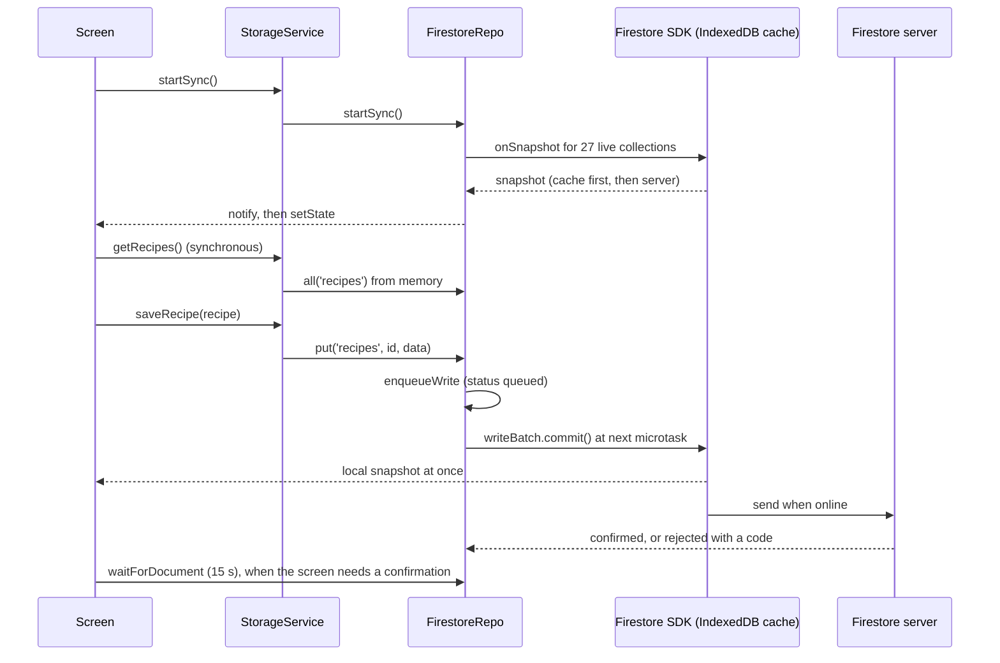
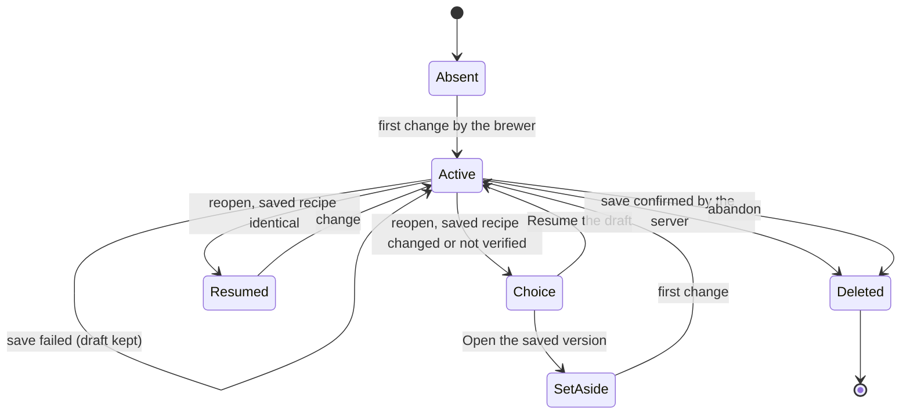
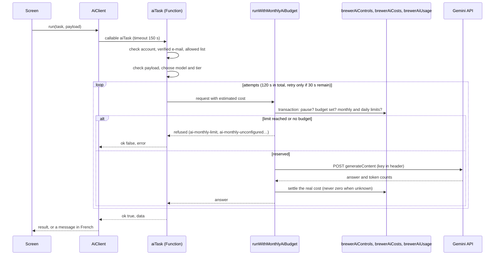

# Architecture — L'Affinée

Status: current state on 18 October 2026, and the changes for the hop redesign
(mission #119, phase 6). Language: English, ASD-STE100 style. Terms:
[glossary](../specs/glossary.md). Each fact refers to a source file. The facts
come from a read-only survey (`work/refonte-frontend/phase6/faits-architecture.md`).

Other documents:
- [hop-logic.md](hop-logic.md): ranking, comparison, simulation and replacement diagrams.
- [Hop specification](../specs/houblons.md): what the Hops step does.

## 1. Stack

| Part | Technology | Version | Source |
|---|---|---|---|
| Interface | React | 19.2 | `package.json` |
| Build | Vite | 6.4 | `vite.config.ts` |
| Language | TypeScript | 5.9 | `tsconfig.json` (includes `src` only) |
| Styles | Tailwind CSS | 3.4 | `tailwind.config.js`, tokens in `DESIGN.md` |
| Cloud data | Firebase SDK (Firestore, Auth, Functions, App Check) | 11.10 | `src/services/firebase.ts` |
| Local data | Firestore persistent cache (IndexedDB); Dexie 4.4 for 4 side stores | — | `src/services/firebase.ts:72-74` |
| Server | Cloud Functions, Node 22, region europe-west6 (Zurich) | firebase-functions 6.3 | `functions/src/index.ts:6-7` |
| Tests | Vitest 3.2; Puppeteer checks in `scripts/check-*.mjs` | — | `vitest.config.ts` |
| Hosting | Firebase Hosting, folder `dist` | — | `firebase.json` |

There is no CI workflow in the repository.

## 2. Start of the app

1. `index.html` loads `src/main.tsx` as a module.
2. `src/main.tsx` shows "Chargement de la brasserie…" at once.
3. It imports `./App` and `./services/firebase` in parallel (`src/main.tsx:86-89`).
4. It connects the emulators (development only), starts App Check, then renders `App`.
5. `App` checks the session, then shows the login screen or the tabs.
6. After login, `StorageService.startSync()` opens the live collections (`src/App.tsx:273`).

`App` loads 13 screens on demand (`React.lazy`, `src/App.tsx:62-74`), for example
`BrewWizard` (recipe creator) and `HopV55Host` (current hop workshop). Measured on
18 October 2026: the JavaScript before the first screen is 918 kB gzip
(`App` 704 kB, `firebase` 152 kB, `index` 62 kB). The Hops step adds 772 kB gzip.

## 3. Data and offline operation

### 3.1 Where the data is

| Data | Store | Source |
|---|---|---|
| Business data (recipes, stock, batches, finances…) | Firestore, with the persistent SDK cache in IndexedDB | `src/services/firebase.ts:72-74` |
| Reads by the screens | Memory cache of `FirestoreRepo`, filled by snapshots | `src/services/firestoreRepo.ts:378-380` |
| Recipe draft | `localStorage`, key `laffinee_recipe_draft_v1:<user>:<id>` | `src/services/recipeDraft.ts:40` |
| Interface state | `localStorage`, `laffinee_ui_state` | `src/services/storage.ts:53-56` |
| Hop workshop V5.5 files, decision files, scenarios | 4 Dexie databases (not business data) | `src/services/hopV55/workspaceRepository.ts:57` and others |
| Financial ledger | IndexedDB store `laffinee-financial-ledger-v1` | `src/services/financialLedgerCache.ts:6` |

There is no caching service worker. `public/brew-alerts-sw.js` handles push
notifications only.

### 3.2 Read and write path

`StorageService` (`src/services/storage.ts`) is the facade for all screens. Reads
are synchronous: they come from the memory cache. Writes go into a queue. The
queue sends one Firestore batch at the next microtask.

### 3.3 Offline and resume

- Offline, the SDK keeps the writes in its persistent cache. The reads come from the cache.
- When the network or the focus comes back (`online`, `focus`, `pageshow`,
  `visibilitychange`), `resumeSync` reopens the failed collections and reads
  the failed documents again (`src/services/firestoreRepo.ts:425-440`). It waits
  15 s between two attempts.
- The SDK sends the queued writes again. The app does not replay them itself.
- Some error codes are final (for example `permission-denied`); the app does not
  send these writes again (`src/services/firestoreRepo.ts:96`).

## 4. Firestore

- 30 business collections (`functions/src/dataSchema.ts:2-8`). The app opens 27
  of them in real time at login, including 5 hop collections (`hopVarieties`,
  `hopLots`, `hopKnowledge`, `hopPredictions`, `hopTastings`), before the brewer
  opens a hop screen.
- The rules come from `firestore.rules.template` and `scripts/build-rules.mjs`. Each
  business collection has a rule; all other paths are refused. Access needs a
  signed-in account with a verified e-mail in the allowed list.
- Rules also keep invariants: stock never negative, transactions and payments
  checked, batch stock frozen after consumption.
- Production data on 17 October 2026 (read-only): 12 hop varieties, 18 hop stock
  items, 23 recipes (#120).

## 5. Recipe draft

The recipe creator (`src/pages/BrewWizard.tsx`) keeps the draft in
`localStorage`. The draft never goes to the server before the brewer saves.

- The draft carries a SHA-256 fingerprint of the saved recipe
  (`src/services/recipeDraft.ts:522-531`). At reopen, the fingerprint tells if the
  saved recipe changed.
- Opening the creator or changing the step does not write a draft. Only a change
  by the brewer does (`src/pages/BrewWizard.tsx:1921-1932`).
- Save: `saveRecipeConfirmed` writes the recipe, then waits up to 15 s for the
  server confirmation (`src/services/recipeSave.ts:25-44`). The draft is deleted
  only after the confirmation.

## 6. Cloud Functions

48 exports (`functions/src/index.ts:9-50`): 35 callable functions, 8 document
triggers, 3 task queues, 2 scheduled jobs. Main groups:

| Group | Functions | Note |
|---|---|---|
| AI gateway | `aiTask` | Gemini on the server; see section 7 |
| Brewer assistant | `askBrewer`, `processBrewerQuestion`, `getBrewerActivity`, … | Task queue, monthly budget |
| Hop advice V1 to V6 | `askBrewerHopAdviceV1`, `processBrewerHopAdviceV1`, … | Not available in the app by default; refused by the API (HTTP 400, #103) |
| Catalogue | `readBrewingCatalogue`, `writeBrewingCatalogue` | Adds embedded references to Firestore varieties |
| Data safety | `exportBreweryData`, `restoreBreweryData`, `recordDataChange` | History of business writes in `dataHistory` |
| Finances | `syncFinancialLedger`, `recordFinancialTransactionChange`, … | Ledger by pages |
| Brew day | `syncBrewAlarms`, `deliverBrewAlarm`, `saveBrewSession`, … | Alarms and push notifications |
| AI budget | `getBrewerAiBudget`, `setBrewerAiBudget` | Monthly budget in CHF |

## 7. AI gateway and budget

- The Gemini key is a server secret (`GEMINI_API_KEY`, `functions/src/ai.ts:38`).
  The client has no key.
- Models: `gemini-3.8-flash`, and `gemini-3.5-flash-lite` for 3 light routes
  (`functions/src/models.ts:24-26`, `:69-73`).
- Time limits: 120 s for a task with its retries, 100 s for one request, 150 s
  for the client (`functions/src/aiTaskDeadline.ts`).
- Each Gemini call goes through `runWithMonthlyAiBudget`. The function reserves
  an estimated cost before the call, then records the real cost.
- If no monthly budget is set, no call goes out. If the budget is reached, the
  task returns an error and the screen offers manual entry.
- Tests never call Gemini: `npm test` runs `scripts/check-test-boundary.mjs`
  first, and a test guard blocks real calls.

## 8. What stays and what changes for the hop redesign

The changes apply only after gate B: the brewer tries the prototype
(`prototypes/houblons/index.html`) and agrees.

### 8.1 What stays

- Stack, Firestore with its persistent cache, `StorageService`, rules, Functions
  and their region.
- AI gateway and monthly budget.
- `BrewingMath.hopIbu` (Tinseth), `hopStage`, `replacementHopDose`,
  `compareHopPrograms`, product rules, the aroma dose-response model
  (`functions/src/hopExtrapolationCore.ts`).
- The recipe draft cycle (section 5).

### 8.2 What changes

| Change | Reason | Check |
|---|---|---|
| A new Hops step replaces `HopV55Host` in the recipe creator | The current step fails the brewer's main request (0 hop of stock in 0 or 1 tap) | `scripts/check-hop-one-tap.mjs` |
| The Hops step loads only the data that it shows | 772 kB gzip today for the step; budget 150 kB | `scripts/check-hop-budget.mjs` (B2) |
| Hop collections open on demand, not at login | 5 hop collections open before any hop screen | budget B1 and #121 |
| Stock item gets a link to its variety, the alpha of the lot and the form | Today: no link, alpha in the name, form in the name (#120) | production snapshot check |
| A sourced style usage and style direction dataset | No data for stout; IPA only | spec F1 |
| A descriptor parser for the Beer Maverick tags | Tags are only in text | spec 3.1 |

### 8.3 What can go, on approval only (#106)

- `src/services/hopV55/` (67 files, about 42 900 lines) and the 4 Dexie databases
  of the hop workshop and decision files.
- Hop advice V1 to V6 (the "brewerHopAdvice" files of `functions/src/`) and its 9
  exported functions.
- Duplicates: `BrewingMath.calculateTinsethIBU` (no production caller),
  `functions/src/hopExtrapolationV3.ts` (duplicate of `hopExtrapolationCore`).

Nothing is deleted without the brewer's approval.

## 9. Risks noted during the survey

| Risk | Fact | Source |
|---|---|---|
| Client allowed list | An empty client list gives access to any account; the server rules and the AI gateway still refuse | `src/services/firebaseAuth.ts:75` |
| Gemini price policy | The price policy expired on 9 October 2026; it is shown, it does not block | `functions/src/geminiCosts.ts:12` |
| Two Tinseth functions | `BrewingMath.hopIbu` and `estimateBoilIbu` both calculate IBU; nobody compared their results | `src/domain/hopDecision/calculations.ts:65-93` |
| No CI | No workflow runs the checks on each change | repository |
| Pending writes | The app keeps its write queue in memory; offline safety comes from the SDK cache | `src/services/firestoreRepo.ts:87` |
