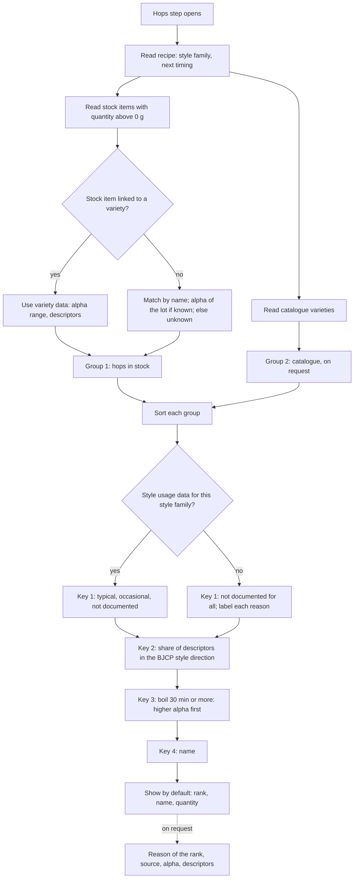
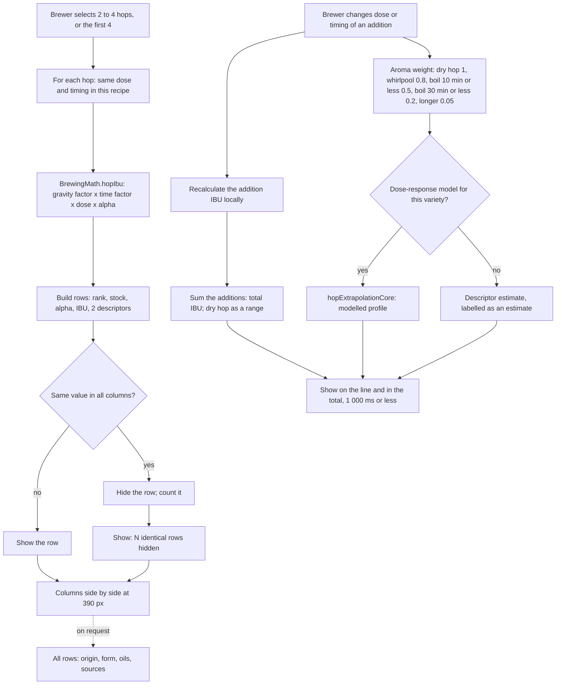
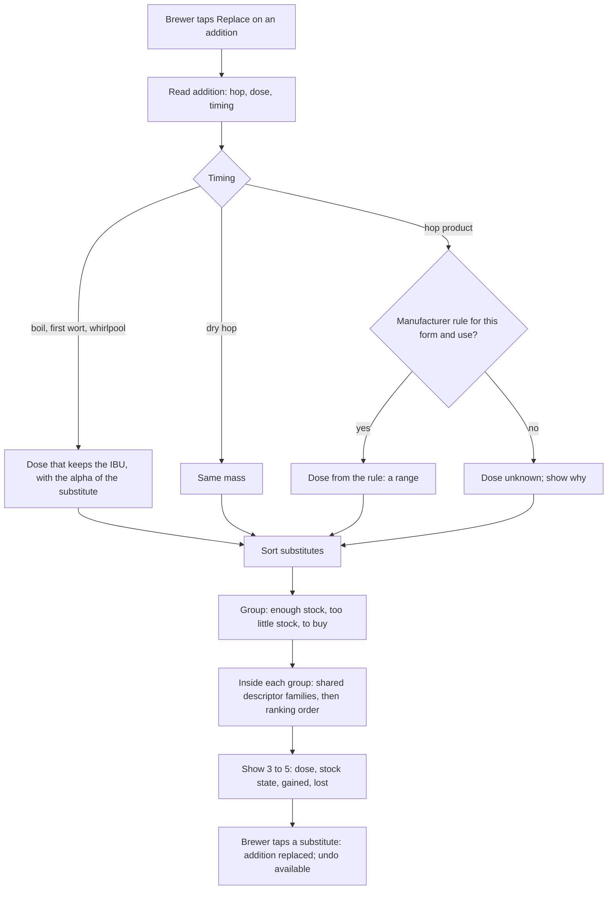

# Hop core logic — diagrams

Status: draft, 18 October 2026 (mission #119, phase 6). Terms:
[glossary](../specs/glossary.md). Behaviour: [hop specification](../specs/houblons.md).

## 1. Ranking of my hops for a style (F1)

## 2. Comparison and simulation (F2, F3)

### IBU of one addition (existing code)

`BrewingMath.hopIbu` in `src/services/brewingMath.ts`:

| Timing | Utilisation |
|---|---|
| boil, t minutes | G × (1 − e^(−0.04 t)) / 4.15 |
| first wort | G × (1 − e^(−0.04 × boil time)) / 4.15 × 1.1 |
| whirlpool, t minutes at T °C | G × (1 − e^(−0.04 t)) / 4.15 × 2^((T − 100) / 10) |
| dry hop | 0 (separate cold bitterness model) |

G = 1.65 × 0.000125^(OG − 1). IBU = dose (g) × 1 000 / volume (L) × alpha / 100 × utilisation.

## 3. Replacement (F4)

